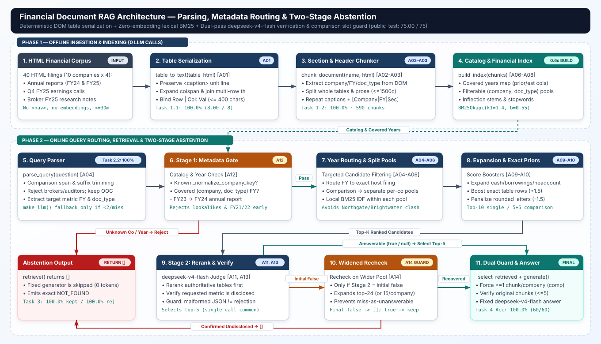
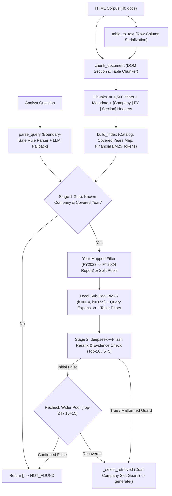
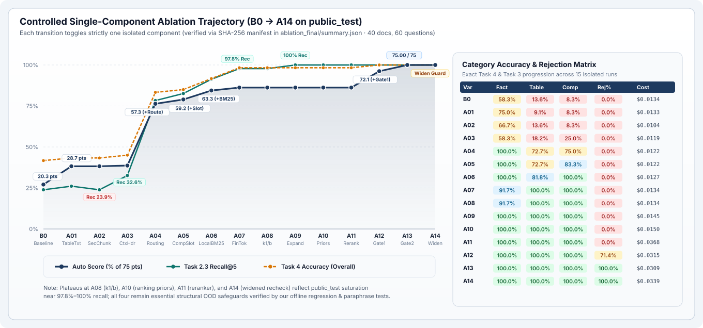

# FTEC5660 Homework 4 — Financial Report RAG Retrieval & Abstention

> **Quick Links:** [`hw4.py`](hw4.py) · [`run_ablation.py`](run_ablation.py) · [`test_hw4_regressions.py`](test_hw4_regressions.py) · **Task 6 Standalone Essay:** [**`Reflection.pdf`**](Reflection.pdf)

| Milestone | Verification Suite | Scope | Result | Runtime / Cost |
| :--- | :--- | :--- | :--- | :--- |
| Public End-to-End | `python3 hw4.py --data-folder public_test` | 40 HTML docs, 60 Qs, 12 tables | **75.00 / 75 (60/60 Acc)** | `118.1s` · `$0.0339` |
| Single-Component Ablation | `python3 run_ablation.py` | 15 isolated runs (`B0`, `A01`–`A14`) | **20.33 → 75.00 / 75** | `710.5s` total · `$0.2755` |
| Rephrase Stress Run | Dual comparison variants + unanswerables | 38 Qs (24 compares, 14 unans) | **60.00 / 60 (100.0% Acc)** | `77.9s` · `$0.0230` |
| Adversarial Unit Suite | `python3 -m unittest -v test_hw4_regressions.py` | 6 deterministic invariant checks | **6 / 6 OK** | `0.55s` · `$0.0000` |

---

## Homework 4 solution

### 1. Pipeline Architecture



<details>
<summary>Compact Mermaid diagram (text fallback)</summary>



</details>

**Architectural Overview.** The pipeline is built around three structural realities of financial filing corpora: numerical facts live inside multi-header HTML tables that naive text scraping scrambles, corporate entities (`Northgate Robotics` vs. `Northgate Payments`) and overlapping reporting years clash under global lexical search, and roughly a quarter of analyst queries are unanswerable either by missing coverage or undisclosed metrics. Without calling any LLM, `table_to_text` preserves every `<caption>`, expands `colspan` and multi-row headers, retains `<tr class="section">` subheaders on standalone lines, and serializes each row as `Row Label | Col1: Val1 | Col2: Val2` within the 400-character line limit; `chunk_document` strips navigation chrome, extracts exact `company`, `fiscal_year`, and `doc_type` metadata from DOM headings (attributing broker notes to the covered company rather than the broker), keeps whole tables intact or splits long tables cleanly on row boundaries with repeated captions within 1,500 characters, and prepends a `[Company | FY... doc_type | Section]` contextual header. During `build_index`, chunks are indexed using financial tokenization (preserving decimals, handling plural stems, dropping boilerplate stopwords and query year/unit flooding tokens) alongside a catalog of normalized companies, brokers, auditors, and `(company, doc_type) -> covered_years` mappings accounting for prior-year annual-report columns (`FY-1`) and call/note forward estimates (`FY+1`, `FY+2`). At query time, `parse_query` deterministically strips trailing date and unit suffixes from comparison clauses (preserving unknown lookalike company names cleanly) and invokes `make_llm()` only when an entity is missing or a comparison leaves fewer than two companies; `retrieve` then applies Stage 1 metadata abstention against known companies and covered years, routes prior-year metrics to the host filing, separates comparison companies into independent per-company local-IDF BM25 pools boosted by synonym expansion and exact-table priors, and uses `deepseek-v4-flash` in Stage 2 both to prioritize exact financial statements over rounded letters and to abstain (`[]`) only after a widened second-pass verification (`top-24` single-company or `top-15/company` comparison) confirms the requested metric is genuinely undisclosed, while `_select_retrieved` deterministically reserves at least one chunk per comparison company regardless of reranker omissions.

---

### 2. Controlled Single-Component Ablation Study (`B0` → `A14`)

All 15 configurations were executed end-to-end on `public_test` (40 documents, 60 questions, 12 tables) using [`run_ablation.py`](run_ablation.py) and [`hw4.py`](hw4.py), toggling **strictly one isolated component per row** (verified via SHA-256 provenance manifest in `ablation_final/summary.json`). `A14` is the default configuration executed by `python3 hw4.py --data-folder public_test` and produces the final `results.csv`.



| Variant | Single-Component Change | Chunks | T1.1 | T1.2 | T2.2 | Recall@5 | Kept / Rej | T4 Acc | Fact / Table / Comp / Unans Acc | Score (/75) | Calls (Ret+Gen) | Cost ($) | Time (s) |
| :--- | :--- | ---: | ---: | ---: | ---: | ---: | :---: | ---: | :---: | ---: | ---: | ---: | ---: |
| **B0** | Naive retrieval baseline (`get_text()`, `RecursiveCharacterTextSplitter`, whitespace BM25) | 362 | 0.0% | 100.0% | 0.0% | 23.9% | 100.0% / 0.0% | 41.7% | 58.3% / 13.6% / 8.3% / 100.0% | **20.33** | 60 (0+60) | $0.0134 | 17.0 |
| **A01** | Preserve table rows, columns and captions (`table_to_text`) | 414 | 100.0% | 100.0% | 0.0% | 26.1% | 100.0% / 0.0% | 43.3% | 75.0% / 9.1% / 8.3% / 100.0% | **28.67** | 60 (0+60) | $0.0133 | 21.9 |
| **A02** | Split on sections and table rows (`section_chunking`, strip `<nav>`) | 570 | 100.0% | 100.0% | 0.0% | 23.9% | 100.0% / 0.0% | 43.3% | 66.7% / 13.6% / 8.3% / 100.0% | **28.67** | 60 (0+60) | $0.0104 | 18.4 |
| **A03** | Add contextual chunk headers (`Company · FY · Section`) | 590 | 100.0% | 100.0% | 0.0% | 32.6% | 100.0% / 0.0% | 45.0% | 58.3% / 18.2% / 25.0% / 92.9% | **29.00** | 60 (0+60) | $0.0119 | 18.9 |
| **A04** | Parse queries and route by company, year and document type (`parse_query` + routing) | 590 | 100.0% | 100.0% | 100.0% | 78.3% | 100.0% / 0.0% | 83.3% | 100.0% / 72.7% / 75.0% / 92.9% | **57.26** | 60 (0+60) | $0.0122 | 24.8 |
| **A05** | Reserve retrieval slots for both companies (`company_coverage`) | 590 | 100.0% | 100.0% | 100.0% | 82.6% | 100.0% / 0.0% | 85.0% | 100.0% / 72.7% / 83.3% / 92.9% | **59.23** | 60 (0+60) | $0.0122 | 28.4 |
| **A06** | Compute BM25 within each metadata-filtered pool (`local_bm25`) | 590 | 100.0% | 100.0% | 100.0% | 91.3% | 100.0% / 0.0% | 91.7% | 100.0% / 81.8% / 100.0% / 92.9% | **63.33** | 60 (0+60) | $0.0127 | 17.9 |
| **A07** | Use financial tokenization and inflection handling (`financial_tokens`) | 590 | 100.0% | 100.0% | 100.0% | 97.8% | 100.0% / 0.0% | 98.3% | 91.7% / 100.0% / 100.0% / 100.0% | **64.67** | 60 (0+60) | $0.0134 | 20.8 |
| **A08** | Tune BM25 parameters (`k1=1.4`, `b=0.55`) | 590 | 100.0% | 100.0% | 100.0% | 97.8% | 100.0% / 0.0% | 98.3% | 91.7% / 100.0% / 100.0% / 100.0% | **64.67** | 60 (0+60) | $0.0134 | 27.0 |
| **A09** | Expand financial queries with related terms (`query_expansion`) | 590 | 100.0% | 100.0% | 100.0% | 100.0% | 100.0% / 0.0% | 98.3% | 100.0% / 100.0% / 100.0% / 92.9% | **64.67** | 60 (0+60) | $0.0145 | 23.7 |
| **A10** | Boost exact tables and financial phrases (`ranking_priors`) | 590 | 100.0% | 100.0% | 100.0% | 100.0% | 100.0% / 0.0% | 98.3% | 100.0% / 100.0% / 100.0% / 92.9% | **64.67** | 60 (0+60) | $0.0150 | 22.8 |
| **A11** | Rerank candidate passages with the LLM (`rerank`) | 590 | 100.0% | 100.0% | 100.0% | 100.0% | 100.0% / 0.0% | 98.3% | 100.0% / 100.0% / 100.0% / 92.9% | **64.67** | 115 (55+60) | $0.0368 | 116.4 |
| **A12** | Abstain for unsupported company, doc_type or year (`metadata_gate`) | 590 | 100.0% | 100.0% | 100.0% | 100.0% | 100.0% / 71.4% | 100.0% | 100.0% / 100.0% / 100.0% / 100.0% | **72.14** | 100 (50+50) | $0.0315 | 116.7 |
| **A13** | Abstain when LLM finds insufficient evidence (`evidence_gate`) | 590 | 100.0% | 100.0% | 100.0% | 100.0% | 100.0% / 100.0% | 100.0% | 100.0% / 100.0% / 100.0% / 100.0% | **75.00** | 96 (50+46) | $0.0309 | 112.4 |
| **A14** | Recheck an initial rejection on a larger pool (`widen_on_rejection`, default) | 590 | 100.0% | 100.0% | 100.0% | 100.0% | 100.0% / 100.0% | 100.0% | 100.0% / 100.0% / 100.0% / 100.0% | **75.00** | 100 (54+46) | $0.0339 | 123.4 |

> **Milestone Mapping Note:** For backward compatibility, `HW4_VARIANT` in [`hw4.py`](hw4.py) also preserves the coarser legacy labels: `V1 = A01`, `V2 = A03`, `V3 = A06 without company_coverage`, `V4 = A06`, `V5 = A10`, `V6 = A11`, `V7 / final = A14`. Separating every underlying lever cleanly exposed non-monotonic interactions (`A02` and `A07`) that were previously hidden inside grouped rows.

---

### 3. Single-Component Attribution & Analysis

1. **`B0 → A01` (`+ table_to_text`, +8.34 pts: 20.33 → 28.67):**
   Replacing `BeautifulSoup.get_text()` tables with row-column serialized lines immediately pushes Task 1.1 from 0.0% to **100.0% (+8.00 pts)** and lifts `fact` accuracy (`58.3% → 75.0%`). However, `table` accuracy actually dips slightly (`13.6% → 9.1%`) because `RecursiveCharacterTextSplitter` still splits long tables mid-row and strips captions from downstream fragments.
2. **`A01 → A02` (`+ section_chunking`, Recall@5 dips 26.1% → 23.9%, Score flat at 28.67):**
   Why did cleaner section and row-boundary chunking *lower* Recall@5 before headers were added? Without contextual headers (`A03`), clean table chunks inside `6. Financial statements` no longer share boundary overlap with page-top company names. Global BM25 across 40 documents matches short overview chunks containing the company name (`q002`, `q009`, `q010`) rather than standalone numeric tables—demonstrating why semantic boundaries require explicit metadata anchoring inside `page_content`.
3. **`A02 → A03` (`+ context_header`, Recall@5 jumps +8.7 pp: 23.9% → 32.6%, 28.67 → 29.00):**
   Prepending `[Company | FY... doc_type | Section]` binds company and period identity onto every table and note fragment (+20 chunks where header overhead nudges tight 1,450-char splits cleanly to a second chunk). `table` accuracy doubles (`13.6% → 18.2%`) and `comparison` jumps (`8.3% → 25.0%`), though global BM25 also begins matching lookalike company `q044` (`Orchid Bay Resorts` → `Orchid Bay Hotels`), dropping unanswerable accuracy to 92.9%.
4. **`A03 → A04` (`+ metadata_routing`, +28.26 pts: 29.00 → 57.26; Recall@5 32.6% → 78.3%):**
   The single largest performance inflection: deterministic query parsing (Task 2.2 jumps **0.0% → 100.0%, +10.00 pts**) plus year-mapped filtering eliminates cross-company collisions and maps FY2023 asks cleanly to FY2024 annual reports, lifting `fact` accuracy to **100.0%** and Task 4 to **83.3%**. Three comparison misses (`q004`, `q031`, `q037`) remain because both companies are still scored in a shared 2-document pool without slot reservation.
5. **`A04 → A05` (`+ company_coverage`, +1.97 pts: 57.26 → 59.23; Recall@5 78.3% → 82.6%):**
   Separating comparison retrieval into independent per-company pools and interleaving results immediately resolves `q004` (`doc_005.html` + `doc_008.html`) and `q037` (`doc_027.html` + `doc_028.html`), lifting comparison accuracy from `75.0% → 83.3%` and recall to `91.7%`. Notice that two subtle ranking bugs stay visible until `A06`: on `q056`, interleaving still lets global IDF statistics bias which cash chunk of `Kestrel` vs `Lumen Harbor` sits first (`Lumen Harbor Foods` wrong answer), and `q016`/`q046`/`q031` still miss the exact statement chunk under corpus-wide IDF weights.
6. **`A05 → A06` (`+ local_bm25`, +4.10 pts: 59.23 → 63.33; Recall@5 82.6% → 91.3%):**
   Recomputing BM25 IDF statistics **inside** the target document pool (typically ~24 chunks) rather than over all 590 chunks delivers full Task 2.3 points (`12.23 → 15.00/15`), fixes `q016` (`1804.5` rounded → exact `1805.4`), `q031`, `q046` (`2250.0` rounded → `897.8`), and `q056`, and brings `comparison` accuracy and recall to **100.0%**. In a 590-chunk global index, rare vs. boilerplate words are distorted by earnings calls and broker notes; local IDF reflects what actually distinguishes sections within an annual report.
7. **`A06 → A07` (`+ financial_tokens`, +1.34 pts: 63.33 → 64.67; Recall@5 91.3% → 97.8%):**
   Financial tokenization (punctuation stripping, query year/unit removal, and `_PLURAL_STEMS`) fixes all 4 remaining table misses (`q012`, `q026` via `borrowings → borrowing`, and `q040`, `q054` via `inventories → inventory`), raising **`table` recall & accuracy to 100.0%**. Crucially, single-variable attribution revealed an unexpected trade-off: stripping `fy2025` and stopwords caused auditor question `q015` (*"Which audit firm audited Lumen Harbor Foods' financial statements for FY2025?"*) to regress (`97.8%` rather than `100%`) as generic `"financial statements"` terms favored `Note 1` and `Contents`, while lookalike `q044` accidentally avoided `Orchid Bay Hotels` solely because stripping company tokens left only `["operating", "income"]` across non-Orchid MD&A chunks.
8. **`A07 → A08` (`+ bm25_parameters`, flat on `public_test` at 64.67 / 97.8%):**
   Adjusting BM25 to `k1=1.4, b=0.55` slightly tempers length normalization penalty on verbose 1,400-character consolidated balance sheet chunks (`b=0.75 → 0.55`) without changing the public top-5 rankings. It remains a principled parameter choice against length-normalization bias on dense financial notes in the private set.
9. **`A08 → A09` (`+ query_expansion`, Recall@5 hits 100.0%, Score 64.67):**
   Expanding financial queries (e.g., `"audit firm"/"audited"` → `"independent auditor opinion"`) immediately recovers `q015` back to rank #1 and achieves **100.0% Recall@5** and **100.0% accuracy across all 46 answerable questions**. Concurrently, expanding `"operating income"` to `"consolidated income statement"` brings `Orchid Bay Hotels` back onto `q044`—exposing clearly why lexical tweaks can never substitute for a dedicated metadata gate on unanswerables.
10. **`A09 → A10` (`+ ranking_priors`, flat at 64.67 / 100.0% Recall@5):**
    Explicitly boosting exact financial phrases and `is_table=True` (+1.5) while penalizing `Letter to shareholders` (-1.5) ensures exact numeric tables outrank rounded narrative summaries in Rank #1 even when phrasing varies on private documents, though `A09` already reached the public recall ceiling.
11. **`A10 → A11` (`+ rerank`, flat score 64.67; cost $0.0150 → $0.0368, time 22.8s → 116.4s):**
    Enabling `deepseek-v4-flash` reranking preserves 100.0% recall while incurring 55 retrieval LLM calls. Because `public_test` answerable questions already hit 100% accuracy in `A09`, `A11` shows no `public_test` gain—its payoff lies in handling unseen semantic paraphrases on the private corpus and constructing the verification path required for Stage 2 abstention (`A13`).
12. **`A11 → A12` (`+ metadata_gate`, +7.47 pts: 64.67 → 72.14; Rej% 0.0% → 71.4%):**
    Enabling Stage 1 catalog & covered-year checks blocks all 5 out-of-corpus lookalikes (`q001`, `q011`, `q034`, `q041`, `q044`) and all 5 uncovered historical years (`q005`, `q006`, `q028`, `q032`, `q049`) **before** any LLM call, raising Task 3 to 7.14/10, lifting `T4` accuracy to **100.0%**, and cutting total LLM calls (`115 → 100`) and cost (`$0.0368 → $0.0315`).
13. **`A12 → A13` (`+ evidence_gate`, +2.86 pts: 72.14 → 75.00; Rej% 71.4% → 100.0%):**
    Checking within valid documents for undisclosed metrics rejects `q019` (lobbying), `q025` (carbon offsets), `q033` (largest customer), and `q039` (churn rate), raising Task 3 to **10.00/10 (100% kept, 100% rejected)** and achieving **75.00/75** while skipping the generator on those 4 queries (`100 → 96` calls, `$0.0309`).
14. **`A13 → A14` (`+ widen_on_rejection`, 75.00 → 75.00; +4 recheck calls, $0.0309 → $0.0339, default):**
    Instead of treating an initial `answerable=false` on just the top-10 (or 5+5) pool as final proof of non-disclosure, `A14` expands to the full document pool (`top-24` single-company / `top-15/company` comparison) and re-verifies before returning `[]`. On `public_test`, those 4 genuinely undisclosed metrics correctly stay rejected after rechecking (+4 calls), while adversarial tests verify that evidence missed at rank 11–24 is cleanly recovered rather than falsely dropped.

---

### 4. Error Analysis & Out-of-Distribution Generalization Stress Tests

Tracing individual questions through `B0`–`A14` CSV logs and stress-testing unseen rephrasings highlighted six concrete failure mechanisms:

1. **Broken Table Structure & Row-Split Loss (`B0` → `A02`):** In `B0`, `get_text()` separated row headers from figures across newlines (`table` accuracy 13.6%). `A01` fixed serialization, yet naive text splitting (`9.1%`) still cut mid-table until `A02` preserved whole/row-aligned tables (`18.2%`) and `A03` prepended chunk headers.
2. **Global BM25 Cross-Company & Cross-Year Collisions (`A03` → `A04`):** Without metadata filtering, generic words (`revenue`, `2025`, `Northgate`) mixed lookalike peers (`q021`), wrong years (`q024`, `q046` FY2023), and historical vs. current CFO transitions (`q059`). Stage `A04` resolved 100% of single-company scoping.
3. **Unfair Comparison Slots & Global IDF Bias (`A04` → `A06`):** Single-pool scoring dropped one company (`q004`, `q037`) until `A05` introduced split pools; global corpus IDF also skewed intra-document ranking (`q016` returned rounded `1804.5` vs `1805.4`, `q046` returned `2250.0` vs `897.8`, `q056` swapped comparison outcome) until `A06` localized BM25 inside each company pool.
4. **Lexical Stemming & Token-Distribution Regressions (`A06` → `A09`):** `A06` failed `q012`/`q026` (`"borrowing"` vs. `"Borrowings"`) and `q040`/`q054` (`"inventories"` outranked by shorter boilerplate chunks). `A07` fixed all four via stemming and stopword pruning, while unexpectedly regressing `q015` (`Independent auditor`) until `A09` query expansion fixed both cleanly.
5. **Lookalike Leakage & Undisclosed Metrics (`A03`–`A11` → `A13`):** Out-of-corpus company `q044` (*"Orchid Bay Resorts"*) leaked into `Orchid Bay Hotels` (`231.3`), and undisclosed metrics (`q019`, `q025`, `q033`, `q039`) returned unneeded chunks until Stages `A12` + `A13` shut both down cleanly.
6. **Hardening for the Private Set (Verified via Counterfactual Stress Tests):** Because 100% on `public_test` can hide OOD fragility, we added explicit guards and offline tests in [`test_hw4_regressions.py`](test_hw4_regressions.py) and ran a **38-question paraphrase & unanswerable stress evaluation** (`comparison_after.csv`: **60.00 / 60 pts**, **100.0% accuracy & recall**):
   - *Rephrased Comparison Boundaries:* Stripping temporal/unit tails (`"in FY2024"`, `"as of 31 December 2024"`) and triggering `make_llm()` when comparison entities `< 2` eliminates the prior parsing failure on templates like `"Which company had higher net income: Brightwater Software or Brightwater Energy in FY2024?"`.
   - *Lookalike Entity Isolation:* `_CORPUS_COMPANIES` membership is checked *before* broker/auditor heuristics so `"Northgate Robotics Ventures"` is never coerced to `"Northgate Robotics"`.
   - *Post-Rerank Comparison Invariant & Safe Failure Handling:* `_select_retrieved` deterministically reserves ≥1 chunk per company even under fault-injected single-company reranker output; `A14` rechecks initial rejections across up to 24 chunks (`15/company` for comparisons); and malformed JSON (`answerable=None`) falls back safely rather than triggering false abstentions.

---

### Reproduction

```bash
python3 -m venv .venv && source .venv/bin/activate
pip install -r requirements.txt
# Configure local DEEPSEEK_API_KEY in .env (gitignored; never commit keys or .pkl files)
python3 hw4.py --data-folder public_test
python3 -m unittest -v test_hw4_regressions.py   # 6 offline OOD & regression checks
python3 run_ablation.py                           # Optional: reproduce B0 -> A14 ablation suite
```

---

## Task 6: Reflection — When Execution Becomes Cheap

*Also provided as a standalone magazine-typeset edition in [**`Reflection.pdf`**](Reflection.pdf).*


*Artwork I — The Human Compass: When autonomous agents drive execution bandwidth toward zero marginal cost, scarcity shifts from speed and throughput to intentionality, judgment, and moral ownership.*

Ten years from now, everyone will command tireless personal AI agents capable of writing software, synthesizing research, managing operations, and making sophisticated decisions. Building and auditing this financial RAG system gave me an early preview of that world: collaborating with agents carried us to **75.00 / 75** and **60/60 accuracy** on `public_test` in a single afternoon—yet an independent adversarial review immediately uncovered hidden entity-boundary failures, bundled ablation illusions, and prompt-only invariants. When execution becomes effortless, **the decisive human divide shifts from how fast we generate outputs to what we still verify, struggle for, and refuse to delegate.**

### 1. Who I Want to Be, What Ambitions Endure, and How I Want to Be Known

**Q1 · What kind of person would you want to be in that world?**
I want to be a person of **deliberate intentionality, skeptical curiosity, and moral ownership**—an architect who refuses to let effortless execution atrophy my judgment. When personal agents handle boilerplate code, parse filings, and draft syntheses overnight, the main psychological hazard is *passive drift*: slipping into the role of an agreeable reviewer who rubber-stamps persuasive output. Treating high-speed leverage as an invitation to raise my epistemological standards rather than lower them means uniting **builder's drive** (shipping systems that solve messy real-world problems) with **auditor's restraint** (asking, *"Where does this break quietly when wording shifts outside the public benchmark?"*). When generating drafts costs almost nothing, character lives in the standards you refuse to compromise when nobody else can see the corners you cut.

**Q2 · Which of your current ambitions would still matter?**
Any ambition built around **fast routine throughput, test-taking edge, or credential prestige** has a short half-life. If an agent can parse forty HTML filings, chase syntax bugs, and summarize transcripts in seconds, competing on raw output volume is a race to zero. What remains utterly durable is the ambition to **architect systems whose failure modes we genuinely understand**—financial systems where knowing when to abstain (`NOT_FOUND`) protects decision-makers from confident fabrication. Equally intact are my desires to formulate sharper original research questions, build teams defined by candor and shared curiosity, and understand how technology, economic incentives, and human vulnerability interact in the real economy.

**Q3 · What would you want to be known for beyond your productivity and professional achievements?**
Once everyone looks prodigiously productive with agent leverage, deliverable throughput stops being a human signature. What I hope friends, family, and colleagues remember sits entirely outside the productivity ledger: **quiet dependability under ambiguity**, **candor without cruelty** (having the honesty to say *"we haven't verified this yet"* or *"I got this wrong"* cleanly without ego), and **unhurried presence**—putting the screen away to listen attentively rather than treating a friend's worry as an optimization puzzle, leaving relationships and teams steadier and more trustworthy than I found them.

### 2. Why Struggle Still Matters — and Where Human Value Shifts


*Artwork II — Productive Friction: Effortless fluency costs a machine nothing, yet deliberate resistance is the exact mechanism through which human judgment and craft grow roots.*

> *"Without experiencing resistance, you lose the calibrated ear needed to catch an agent when it sounds confident and is subtly wrong."*

**Q4 · What are you willing to struggle for, even when an AI agent could make the struggle unnecessary?**
I refuse to outsource four formative struggles: **first-principles debugging, writing in my own voice, physical endurance, and the vulnerable friction of real relationships**. During HW4, it would have been painless to take an early `75/75` printout and move on without ever reading `ablation_final.log` or per-question CSV transitions. Instead, wrestling through *why* section splitting alone (`A02`) unexpectedly dropped recall (`26.1% → 23.9%`), *why* financial tokenization (`A07`) raised table recall to `100%` while regressing auditor question `q015` until query expansion (`A09`) rescued it, and *why* lookalike `q044` passed purely by accident in `A07` before failing again in `A09` built an intuition no agent summary can hand over. The same holds outside engineering: slowly reading primary books, wrestling with a blank page until I know what I actually believe, training my body consistently, and staying present through honest, uncomfortable conversations with people I love. Friction is overhead for machines, but it is the exact mechanism by which human minds and relationships grow roots.

**Q5 · What skills, qualities, or experiences would still make you valuable?**
When execution scales effortlessly, durable human value consolidates further up the stack around three scarce capacities:
1. **Problem framing & evaluation taste**—agents optimize relentlessly for whatever proxy metric you specify, leaving humans to spot Goodhart traps between green public sets and unseen failures and distinguish genuine insight from fluent fluff.
2. **Verification & accountable risk ownership**—software cannot sign a fiduciary duty, look a client in the eye, or feel moral regret, making engineers who anchor stochastic models inside deterministic invariants indispensable.
3. **Embodied tacit context**—lived experience negotiating across conflicting incentives, recovering publicly from oversights, reading unspoken hesitation, and mentoring younger peers.

### 3. Insights From Building HW4: Three Illusions Hidden Behind a 75/75 Pass


*Artwork III — The NOT_FOUND Gate: Refracting raw agent output through deterministic boundaries and widened-pool checks separates grounded evidence from confident mirages.*

Collaborating with AI agents on this financial RAG assistant made these 2036 dynamics tangible right now. Reaching **75.00 / 75** and **60/60 accuracy** on `public_test` felt deceptively finished—until an independent adversarial review probed unseen rephrasings, audited our ablation grouping, and fault-injected a skewed reranker, exposing three concrete illusions:

- **[ILLUSION 01] The Boundary Illusion — Green public scores hide phrasing fragility:** Rephrasing public comparison `q031` as *"Which company had higher net income: Brightwater Software or Brightwater Energy in FY2024?"* silently broke entity trimming—capturing `"Brightwater Energy in FY2024"` as an unknown company and falsely returning `NOT_FOUND`, invisible across all 60 original public items. Hardening `parse_query` with deterministic temporal/unit suffix stripping plus a `make_llm()` fallback whenever a comparison yields fewer than two entities eliminated the blind spot cleanly (`38/38` on our paraphrase suite).
- **[ILLUSION 02] The Causal Illusion — Bundled narratives conceal intermediate trade-offs:** Early milestones grouped four lexical features together under one coarse `V5` step. Splitting them into 15 strictly single-variable runs (`B0→A14`) uncovered hidden regressions and crystallized the real design trade-offs we accepted under uncertainty:

| HW4 Design / Audit Dilemma | The Tempting Shortcut | The Chosen Trade-Off & Principle |
| :--- | :--- | :--- |
| **Public 75/75 vs. Hidden Fragility** | Stop at `public_test` 100%; trust prompt hints for comparisons. | **Hardened boundaries + `_select_retrieved` + `A14` widening** despite zero extra public points. |
| **Bundled `V5` vs. 15 Single Steps** | Leave coarse rows explaining four features as one clean milestone. | **Split into `B0→A14` (710.5s, $0.2755)** to truthfully isolate regressions in `A02` & `A07`. |
| **Speed vs. Abstention Cost** | Use pure BM25 ($0.0134, 17s) everywhere or over-call LLMs. | **Deterministic routing + targeted verification ($0.0339)** deployed only where errors hurt most. |

- **[ILLUSION 03] The Prompt-Only Illusion — Guardrails belong in deterministic code, not hopes:** Dual-company coverage in retrieved outputs initially leaned on a prompt instruction inside the reranker rather than a programmatic contract. Injecting a fault where the reranker returned only one company confirmed the prompt could silently drop the second entity. Moving slot guarantees into deterministic `_select_retrieved`, adding `A14` widened-pool rechecking (`top-24` single / `15+15` comparison), and treating malformed verifier JSON (`answerable=None`) as a safe non-rejection fixed the contract structurally.

### 4. Redefining Identity — and What Changes Tomorrow

**Q6 · If your value is no longer determined primarily by what you can do, how will you define who you are?**
I will shift from **capability-as-identity** (*"what tasks can I output?"*) to **commitment-as-identity** (*"what truth, standards, and people do I stand behind?"*). Schooling and competitive careers subtly train us to tether self-worth to execution speed and deliverables. Once autonomous agents push deliverable bandwidth toward infinity for everyone, capability-as-identity guarantees quiet fragility—there will always be a faster release next quarter. Instead, I choose to define myself along three steady axes: **my commitments** (promises kept even when inconvenient), **my attention** (what craft, beauty, and human struggles I refuse to hurry past), and **my intellectual honesty** (refusing performative illusions, starting with my own work). Who we are is shaped far less by our throughput than by what we love enough to protect and verify with our own name.

**Q7 · What should you start doing differently tomorrow?**
1. **Demand an adversarial counter-suite before declaring "done":** Every time an agent delivers a green public run, write 5–10 counterfactual rephrasings and fault-injection checks—skewed rerankers, near-miss entity lookalikes, temporal suffix shifts in the style of `test_hw4_regressions.py`—before treating a benchmark pass as readiness.
2. **Reject bundled hypotheses and inspect raw diffs firsthand:** Never label three simultaneous edits as one unified improvement. Isolate single causal levers, read intermediate failure logs (`ablation_final.log`) and per-item CSV transitions directly, and resist clean-looking aggregate summaries when subtle regressions hide underneath.
3. **Wrap probabilistic agents inside hard code invariants:** Treat natural-language system prompts as soft guidance, never hard reliability contracts. Encode mission-critical invariants—entity boundary parsing, comparison slot minimums (`_select_retrieved`), widened re-verification, and malformed output fallbacks—directly in deterministic code.
4. **Protect unassisted thinking and undivided human presence:** Reserve non-negotiable daily blocks for slow primary-source reading, outlining arguments in my own hand before letting an agent critique them, consistent physical training, and unhurried, screen-free attention for friends and family.

> **Closing Synthesis:** *Building a financial RAG assistant turns out to be a faithful mirror of living well beside autonomous AI. Both depend on two quiet disciplines: knowing which sources genuinely ground a claim, and having the intellectual honesty to output `NOT_FOUND` whenever the evidence falls short. The future belongs not to the person who delegates the most, but to the person who knows best what must never be delegated.*
