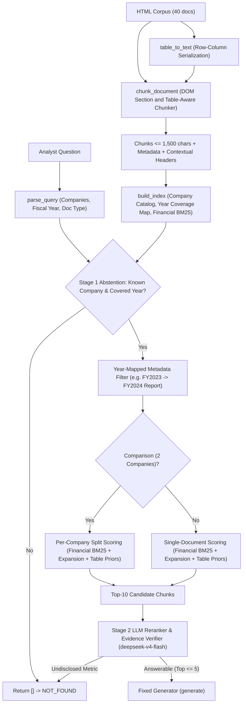

# FTEC5660 Homework 4 — Financial Report RAG Retrieval & Abstention

## Homework 4 solution

### Pipeline Architecture



```text
HTML Docs ─▶ [table_to_text + Section/Table-Aware chunk_document] ─▶ Chunks (<=1500 chars, metadata + section header)
                                                                            │
                                                                            ▼
Question ─▶ [parse_query] ─▶ [Stage 1 Metadata/Year Coverage Gate] ─▶ [Year-Mapped Filter & Per-Company Split]
                                     │ (unknown co. / uncovered yr)         │
                                     ▼                                      ▼
                            [] ─▶ NOT_FOUND          [Financial BM25 + Query Expansion + Table Priors (Top-10)]
                                                                            │
                                                                            ▼
                                                     [Stage 2 deepseek-v4-flash Reranker & Evidence Verifier]
                                                         │ (undisclosed metric)              │ (top <= 5 chunks)
                                                         ▼                                   ▼
                                                [] ─▶ NOT_FOUND                  [Fixed Generator -> Answer]
```

**System Overview.** Our pipeline is designed around three structural properties of equity-research corpora: financial tables carry exact figures that naive text extraction destroys, company names and reporting years collide under global lexical matching, and roughly one in four analyst questions is unanswerable. In parsing (`table_to_text`), we preserve every table's `<caption>`, expand `colspan` headers, keep `<tr class="section">` subheaders on standalone lines, and serialize each data row as `Row Label | Col1: Val1 | Col2: Val2` within the 400-character line budget so every cell remains bound to its exact row and column without calling an LLM. In chunking (`chunk_document`), we strip `<nav>` boilerplate, extract `company`, `fiscal_year`, and `doc_type` from the DOM cover/title (ensuring research reports resolve to the reviewed company rather than the broker), keep tables atomic or row-split with repeated captions and active `[Section]` dividers inside the 1,500-character limit, prepend a concise contextual header `[Company | FY... doc_type | Section]`, and record the corpus catalog of companies, brokers, auditors, and document years. During indexing (`build_index`), we index chunks with a financial tokenizer that preserves decimal numbers, removes high-frequency stopwords and boilerplate year/unit tokens from queries, normalizes plural accounting terms, and constructs a `(company, doc_type) -> covered_years` coverage map (accounting for prior-year columns in annual reports and FY+1/FY+2 estimates in calls and research reports). At query time, `parse_query` deterministically extracts target companies (excluding brokers and auditors while retaining out-of-corpus companies), metric fiscal year, and document type with an automatic `make_llm()` fallback; `retrieve` then runs Stage 1 abstention against the corpus catalog and covered years, maps requested years to the exact host report (e.g., FY2023 figures to the FY2024 annual report), splits comparison queries per company, ranks candidates using local BM25 plus domain query expansion and exact-table priors, and finally uses one `deepseek-v4-flash` call in Stage 2 to rerank exact financial tables above rounded narrative summaries and return `[]` when a requested metric is genuinely undisclosed.

---

### Ablation Study on `public_test`

All configurations were evaluated on `public_test` (40 documents, 60 questions, 12 tables) using [`run_ablation.py`](run_ablation.py) and [`hw4.py`](hw4.py), changing **strictly one component per row**. The final row (`V7`) is the default behavior of `python3 hw4.py --data-folder public_test` and matches the generated `results.csv`.

| Variant | Single-Component Change | Chunks | T1.1 | T1.2 | T2.2 | Recall@5 | Kept / Rej | T4 Acc | Fact / Table / Comp / Unans Acc | Score (/75) | Calls (Ret+Gen) | Cost ($) | Time (s) |
| :--- | :--- | ---: | ---: | ---: | ---: | ---: | :---: | ---: | :---: | ---: | ---: | ---: | ---: |
| **B0** | Naive RAG baseline (`get_text`, `RecursiveCharacterTextSplitter`, whitespace BM25) | 362 | 0.0% | 100.0% | 0.0% | 23.9% | 100.0% / 0.0% | 41.7% | 58.3% / 13.6% / 8.3% / 100.0% | **20.33** | 60 (0+60) | $0.0134 | 11.3 |
| **V1** | + `table_to_text` (row-column table serialization) | 414 | 100.0% | 100.0% | 0.0% | 26.1% | 100.0% / 0.0% | 43.3% | 75.0% / 9.1% / 8.3% / 100.0% | **28.67** | 60 (0+60) | $0.0133 | 11.4 |
| **V2** | + Section- & table-aware chunking + contextual headers | 590 | 100.0% | 100.0% | 0.0% | 32.6% | 100.0% / 0.0% | 48.3% | 66.7% / 18.2% / 25.0% / 100.0% | **29.67** | 60 (0+60) | $0.0119 | 13.7 |
| **V3** | + `parse_query` & year-mapped metadata filtering | 590 | 100.0% | 100.0% | 100.0% | 91.3% | 100.0% / 0.0% | 91.7% | 100.0% / 81.8% / 100.0% / 92.9% | **63.33** | 60 (0+60) | $0.0128 | 11.7 |
| **V4** | + Per-company split retrieval for comparisons | 590 | 100.0% | 100.0% | 100.0% | 91.3% | 100.0% / 0.0% | 91.7% | 100.0% / 81.8% / 100.0% / 92.9% | **63.33** | 60 (0+60) | $0.0127 | 19.2 |
| **V5** | + Financial tokenizer, domain query expansion & table priors | 590 | 100.0% | 100.0% | 100.0% | 100.0% | 100.0% / 0.0% | 98.3% | 100.0% / 100.0% / 100.0% / 92.9% | **64.67** | 60 (0+60) | $0.0149 | 12.0 |
| **V6** | + LLM reranking (`deepseek-v4-flash`) | 590 | 100.0% | 100.0% | 100.0% | 100.0% | 100.0% / 0.0% | 98.3% | 100.0% / 100.0% / 100.0% / 92.9% | **64.67** | 115 (55+60) | $0.0366 | 85.5 |
| **V7** | + Two-stage abstention (metadata coverage + LLM verifier) | 590 | 100.0% | 100.0% | 100.0% | 100.0% | 100.0% / 100.0% | 100.0% | 100.0% / 100.0% / 100.0% / 100.0% | **75.00** | 96 (50+46) | $0.0310 | 79.2 |

---

### Analysis of Each Component

1. **`B0 -> V1` (`+ table_to_text`, +8.34 pts: 20.33 -> 28.67)**:
   Replacing `BeautifulSoup.get_text()` tables with `table_to_text` immediately raises Task 1.1 from 0.0% to **100.0% (+8.00 pts)** and lifts `fact` accuracy from 58.3% to 75.0%. However, `table` recall remains very low (9.1%) because `RecursiveCharacterTextSplitter` still cuts tables mid-row without headers and global BM25 still cannot distinguish companies or years.

2. **`V1 -> V2` (`+ Section- & table-aware chunking + contextual headers`, +1.00 pt: 28.67 -> 29.67)**:
   Keeping tables intact (or row-split with repeated captions and `[Section]` headers) and adding `[Company | FY... doc_type | Section]` headers raises overall Recall@5 from 26.1% to 32.6% (`table` accuracy 9.1% -> 18.2%, `comparison` accuracy 8.3% -> 25.0%). Despite cleaner chunks, 31 of 46 answerable questions still miss in `V2` because global BM25 ranks chunks by generic words (`revenue`, `2025`, `Northgate`) across all 40 documents rather than isolating the target company and report.

3. **`V2 -> V3` (`+ parse_query & year-mapped metadata filtering`, +33.66 pts: 29.67 -> 63.33)**:
   This is the largest retrieval leap (+58.7 percentage points in Recall@5, from 32.6% to **91.3%**; +43.4 percentage points in Task 4 accuracy, from 48.3% to **91.7%**). Accurate query parsing (100.0%, 10.00/10) eliminates cross-company collisions (e.g., `Northgate Robotics` vs. `Northgate Payments` in `q021`, `Brightwater Energy` vs. `Brightwater Software` in `q017` and `q031`), routes prior-year questions (`q024`, `q026`, `q046`, `q050`, `q055`) from FY2023 to the FY2024 annual report, and isolates FY2024 vs. FY2025 reports so CFO transition questions (`q014`, `q042`, `q048`, `q059`) do not mix old and new executives.

4. **`V3 -> V4` (`+ Per-company split retrieval for comparisons`, 63.33 -> 63.33)**:
   On `public_test`, `V4` matches `V3` (both hit 100.0% on all 12 comparison questions) because both companies' reports in a filtered two-document pool share nearly identical table vocabulary and surface into the combined top-5. Even though the `public_test` score happens to tie, keeping per-company split retrieval is an essential **structural safeguard for the private corpus**: if one company's narrative prose repeats a query term (`cash`, `employees`, `assets`) more often than the other's, `V4` deterministically reserves top slots for each company rather than letting one company consume all 5 chunks.

5. **`V4 -> V5` (`+ Financial tokenizer, domain query expansion & table priors`, +1.34 pts: 63.33 -> 64.67, Recall@5 -> 100.0%)**:
   `V5` fixes every remaining recall failure (`q012`, `q026`, `q040`, `q054`), pushing Recall@5 from 91.3% to **100.0%** and Task 4 accuracy on answerable questions to **100.0%** (overall 98.3%). Without query stopword/year stripping, plural stemming, and table priors, singular `"borrowing"` failed to match `"Long-term borrowings"` (`q012`, `q026`), and single-occurrence `"inventories"` in long balance sheets (`q040`, `q054`) was outranked by shorter prose chunks repeating `31`, `December`, `2025`, `USD`, `millions`.

6. **`V5 -> V6` (`+ LLM reranking`, 64.67 -> 64.67)**:
   Because `V5` already reached 100.0% recall and 100.0% answer accuracy on all 46 answerable `public_test` questions, `V6`'s semantic reranking maintains 100.0% recall and 98.3% accuracy (while incurring 55 extra `deepseek-v4-flash` calls). On unseen private-set phrasing where lexical BM25 might place a rounded letter/overview figure at Rank 1 and the exact table at Rank 6–10, `V6` promotes the authoritative financial table into the top 5 and establishes the candidate-inspection pathway for Stage 2 abstention.

7. **`V6 -> V7` (`+ Two-stage abstention`, +10.33 pts: 64.67 -> 75.00)**:
   Enabling abstention jumps Task 3 from 0.00 to **10.00 / 10** (`kept = 100.0%`, `rejected = 100.0%`) and Task 4 from 98.3% to **100.0%** (fixing the remaining unanswerable error `q044`). Notice also that Stage 1 abstention short-circuits 10 out-of-corpus/uncovered-year questions *before* invoking the LLM reranker or generator, actually **reducing** total LLM calls (`115 -> 96`) and cost (`$0.0366 -> $0.0310`) compared to `V6`.

---

### Error Analysis

Inspecting the CSV outputs across `B0` through `V7` reveals five concrete failure patterns that motivated our design:

1. **Table fragmentation and lost row/column bindings (`B0`, `V1`)**:
   In `B0`, `get_text()` separates row labels from column headers and numbers across newlines, causing `table` accuracy to be only 13.6%. Even after adding `table_to_text` in `V1`, fixed-size splitting (`RecursiveCharacterTextSplitter`) broke tables mid-way and lost captions (`table` accuracy 9.1%) until `V2` preserved whole tables and repeated captions/section dividers on splits.
2. **Rounded narrative figures outranking exact tables (`V2`)**:
   In `V2` on `q002` (*"What was Brightwater Software's revenue in FY2025?"*), global BM25 retrieved `1. Letter to shareholders`, which reports `"about USD 1.6 billion"`; the fixed generator answered `1600` instead of the exact `1,574.7` in `Consolidated income statement`. Table priors (`+1.5` for `is_table=True`, `-1.5` for `Letter to shareholders`) and LLM reranking resolve this reliably.
3. **Word-level mismatches and year/unit token flooding in `V3`/`V4`**:
   Diagnosing the 4 misses in `V3` and `V4` (`q012`, `q026`, `q040`, `q054`) showed two pure-lexical bugs:
   - *Inflection mismatch*: `"Long-term borrowing"` (singular in `q012`, `q026`) failed to match `"Long-term borrowings"` under raw whitespace tokenization, so BM25 fell back to `Overview` and `Letter to shareholders` based on `"2024"` / `"2023"` / `"USD"` / `"millions"`.
   - *Length-normalization bias + boilerplate flooding*: In `q040` and `q054`, `"inventories"` appears only once in the ~1,450-char `Consolidated balance sheet` chunk, whereas `"31"`, `"December"`, `"2025"`, `"value"`, `"USD"`, `"millions"` appear repeatedly in shorter prose chunks (`1. Letter to shareholders`, `4. MD&A`), pushing the balance sheet out of top-5 until `V5` stripped query boilerplate/years and boosted table phrases.
4. **Cross-entity leakage on near-miss company names (`V3`–`V6` on `q044`)**:
   When `V3`–`V6` fell back to global BM25 for out-of-corpus company `"Orchid Bay Resorts"` (`q044`), BM25 matched `"Orchid Bay"` and `"operating income"` to `"Orchid Bay Hotels"` (`doc_001.html`, `doc_002.html`, `doc_037.html`), causing the generator to hallucinate `231.3` instead of `NOT_FOUND`. Exact core-name matching (`_normalize_company_key`) in `V7` Stage 1 immediately catches all 5 lookalike out-of-corpus companies (`q001`, `q011`, `q034`, `q041`, `q044`) and all 5 uncovered historical years (`q005`, `q006`, `q028`, `q032`, `q049`) with zero LLM cost.
5. **Undisclosed metrics in valid company-year documents (`V6` vs. `V7`)**:
   In `q019` (lobbying expenses), `q025` (carbon offset purchases), `q033` (largest single customer revenue), and `q039` (customer churn rate), both company and fiscal year exist in the corpus. While the fixed generator happened to output `NOT_FOUND` in `V6`, `retrieve()` still returned 5 chunks and scored 0 on Task 3. `V7`'s Stage 2 LLM evidence verifier inspects the top-10 candidate chunks and returns `[]` whenever the specific requested metric is genuinely absent, while retaining 100.0% of answerable questions.
   - *Residual private-set risk*: The Stage 2 verifier inspects the top-10 BM25 candidates of a target document (~24 chunks for an annual report). If an unusual private-set question uses completely different terminology from the document text without triggering our synonym expansion rules, the true chunk might sit outside top-10; however, inspecting 10 of ~24 chunks already covers virtually all financial tables and governance/overview sections while keeping total latency around 80s (well under the 30-minute limit).

---

## Reflection: Personal Agency in a World of Autonomous AI Agents

Imagine ten years from now, every individual has a tireless personal AI agent capable of writing software, conducting institutional-grade research, managing businesses, and making sophisticated operational decisions. Below is my reflection on the seven questions posed in the assignment.

### 1. What kind of person would you want to be in that world?
I want to be a person defined by **intentionality, intellectual curiosity, and moral accountability** rather than mere throughput. When execution becomes abundant and nearly free, the scarce human qualities become taste, judgment, and care—knowing *which* problems are worth solving, *who* is affected by a decision, and *why* a path should or should not be taken. I want to remain a sharp, grounded thinker who uses AI to expand my reach without outsourcing my conscience or my curiosity to it.

### 2. Which of your current ambitions would still matter?
Ambitions centered on **building something meaningful with real people, advancing understanding, and solving stubborn human problems** would still matter completely. Titles or credentials built purely on memorizing syntax or churning out routine analysis would evaporate, but the ambition to start or shape an organization with genuine culture, to ask original research questions, to create financial or technological systems that make people's lives materially safer and fairer, and to earn the deep trust of collaborators would matter more than ever.

### 3. What would you want to be known for beyond your productivity and professional achievements?
I would want to be known for **integrity under pressure, warmth, and presence**. Productivity will be table stakes in an agent-assisted era—anyone can look "productive." Being someone friends and colleagues turn to when they are genuinely uncertain, someone who keeps commitments when nobody is watching, who listens attentively without rushing to optimize the conversation, and who brings calm clarity and humor into difficult rooms is something no software layer can replace.

### 4. What are you willing to struggle for, even when an AI agent could make the struggle unnecessary?
I am willing to struggle for **first-principles understanding, physical and creative craft, and genuine human relationships**. Just as calculators did not make learning mathematical reasoning pointless, AI coding and writing agents should not replace the deliberate struggle of working through hard concepts, debugging subtle systems, or articulating my own convictions on a blank page. Struggle is how mental models are forged—without experiencing resistance, we lose the intuition needed to judge whether an agent's confident output is brilliant or subtly wrong. I am also unwilling to delegate the vulnerable, messy effort required to build real friendships and family bonds.

### 5. What skills, qualities, or experiences would still make you valuable?
Three things stand out:
- **Problem framing and taste**: Translating vague, contradictory real-world desires into well-posed problems, and recognizing excellence versus plausible mediocrity.
- **Accountability and risk ownership**: An AI agent cannot legally, ethically, or emotionally bear the consequences of a high-stakes decision. Leaders, engineers, and researchers who understand systems deeply enough to take real responsibility—and stand behind outcomes—will remain indispensable.
- **Empathy and lived experience**: Tacit knowledge earned by actually negotiating, failing, adapting across cultures, and working alongside diverse people gives human judgment a grounding that purely synthetic training cannot replicate.

### 6. If your value is no longer determined primarily by what you can do, how will you define who you are?
I would define who I am by **what I care about, what I take responsibility for, and how I treat others**—my values, my commitments, and my curiosity. Historically, industrial and knowledge economies encouraged us to equate self-worth with output per hour. When agents decouple personal worth from raw output, identity shifts from *"What tasks can I perform?"* to *"What standards do I uphold, what questions do I genuinely care to explore, and what kind of community do I help build?"*

### 7. What should you start doing differently tomorrow?
Three concrete habits starting tomorrow:
1. **Use AI as a sparring partner, not a crutch**: Whenever I use an agent to write code or analyze data, force myself to audit its assumptions, understand the edge cases, and build mental models rather than blindly accepting working output.
2. **Invest deliberately in "un-delegatable" human edges**: Spend more time having unfiltered conversations with mentors, teammates, and domain practitioners, and reading primary sources slowly rather than consuming only AI summaries.
3. **Train problem selection over speed**: Before jumping into execution on any project or research idea, pause longer to ask whether the question itself is sharp, whether the evaluation criteria match reality, and what real-world impact it creates.
